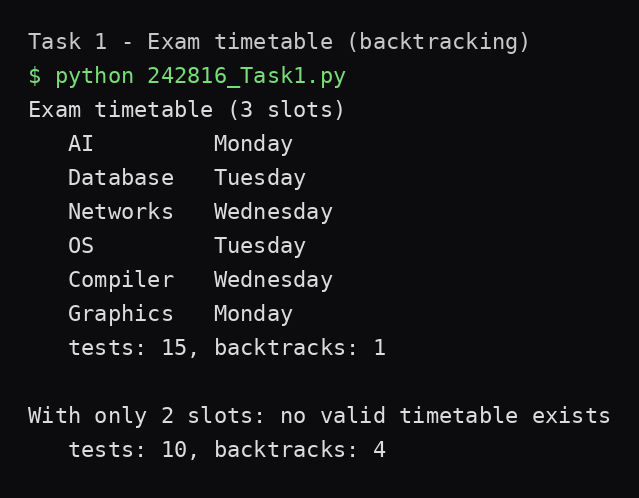
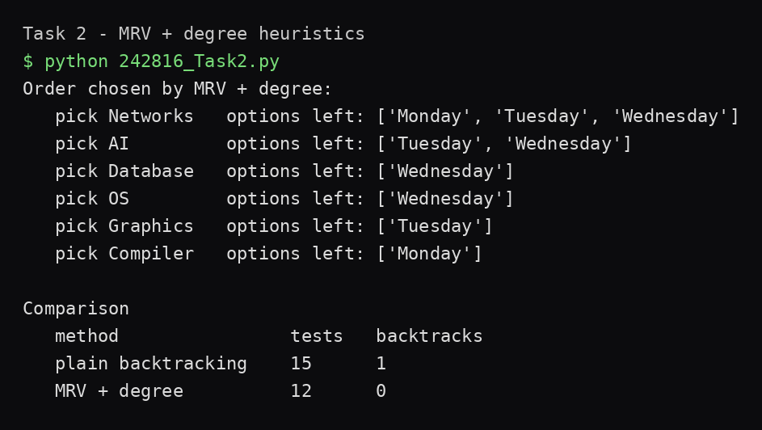
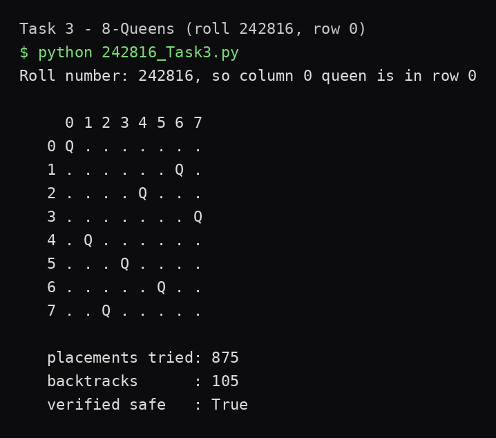

# AI Lab 05 — Constraint Satisfaction Problems

**CS344L — Artificial Intelligence Lab · Week 5 · BSCS, Air University**

Lab 04 searched with heuristics; this lab **constrains** instead of searches blindly. A CSP is a set of **variables**, each with a **domain** of possible values, plus **constraints** that legal assignments must satisfy. The solver here is **backtracking**: assign variables one by one, and when no value fits, undo the last choice and try its next value.

Three programs, plain Python 3, standard library only — no packages installed.

## What's inside

| Task | File | What it does |
|---|---|---|
| 1 | `242816_Task1.py` | Exam timetable as a CSP: 6 courses, 3 day-slots, clash constraint — solved with backtracking; then re-run with 2 slots to prove unsatisfiability |
| 2 | `242816_Task2.py` | Same CSP, but the next course is chosen by **MRV** (fewest legal slots left), ties broken by the **degree** rule (most clashes with unscheduled courses) |
| 3 | `242816_Task3.py` | 8-Queens with column 0 fixed to row `242816 mod 8 = 0`; prints the board, verifies every queen pair, counts placements and backtracks |

The submitted lab report (`242816_lab_05.docx`, also as PDF) contains the answers to Q1–Q6 and the run-window screenshots.

## Verified results

**Task 1 — exam timetable (3 slots):** AI→Monday, Database→Tuesday, Networks→Wednesday, OS→Tuesday, Compiler→Wednesday, Graphics→Monday — **15 tests, 1 backtrack**. With 2 slots: **no valid timetable exists** (10 tests, 4 backtracks).

**Task 2 — heuristic order:** Networks → AI → Database → OS → Graphics → Compiler.

| Method | Tests | Backtracks |
|---|---|---|
| Plain backtracking | 15 | 1 |
| MRV + degree | **12** | **0** |

**Task 3 — 8-Queens** (column 0 fixed to row 0):

```
     0 1 2 3 4 5 6 7
   0 Q . . . . . . .
   1 . . . . . . Q .
   2 . . . . Q . . .
   3 . . . . . . . Q
   4 . Q . . . . . .
   5 . . . Q . . . .
   6 . . . . . Q . .
   7 . . Q . . . . .
```

875 placements tried, 105 backtracks, verified safe: True. Brute force (one queen per column) would build 8⁸ = 16,777,216 boards — backtracking tries 875.





## Key observations

- **Two slots are impossible because of a triangle.** AI, Database and Networks clash pairwise (every pair shares students), so those three courses alone need three different days.
- **Graphics caused Task 1's single backtrack.** With the other five placed, all three days were held by courses Graphics clashes with — the search had to undo Compiler's slot.
- **MRV picks Networks first.** All six courses tie with three legal slots, so the degree rule breaks the tie: Networks clashes with 4 courses, more than any other.
- **Fail-first saves work.** Placing the most constrained course first finds dead ends early — 12 tests and 0 backtracks vs 15 and 1.
- **The fixed queen changes the work.** Row 0 needs 875 placements; row 4 needs only 39 — a different fixed queen attacks different squares, pruning different amounts of the tree early.

## How to run

```bash
python 242816_Task1.py
python 242816_Task2.py
python 242816_Task3.py        # column 0 fixed to row (242816 mod 8) = 0
python 242816_Task3.py 4      # rerun with the first queen forced into row 4 (Q6)
```

## Project structure

```
hussnain-ai-lab-5/
├── 242816_Task1.py
├── 242816_Task2.py
├── 242816_Task3.py
├── screenshots/
│   ├── run_task1.png
│   ├── run_task2.png
│   ├── run_task3.png
│   └── run_task3_row4.png
├── 242816_lab_05.docx        # submitted lab report (Q1–Q6 + screenshots)
├── 242816_lab_05.pdf
└── README.md
```

---
*BSCS coursework — Air University, Islamabad. Lab 04 (informed search) lives in [hussnain-ai-lab-4](https://github.com/hussnainahmedd/hussnain-ai-lab-4).*
